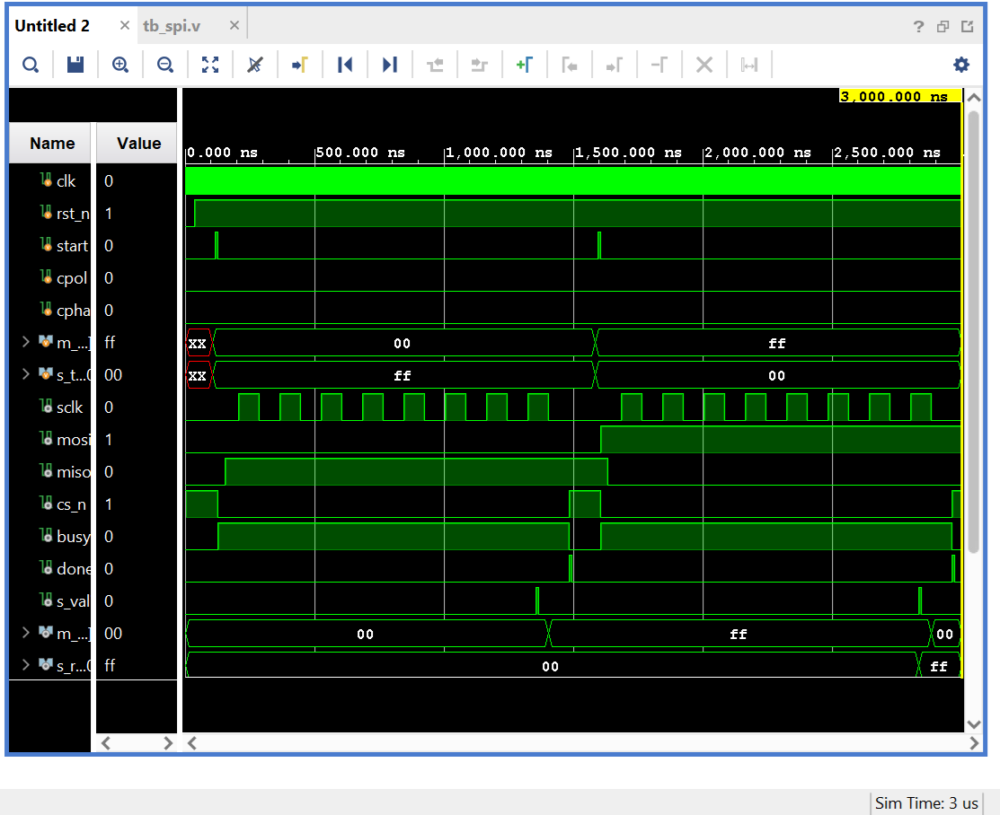
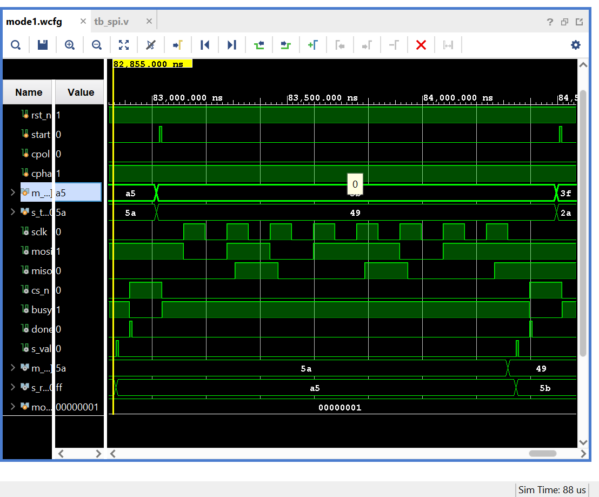
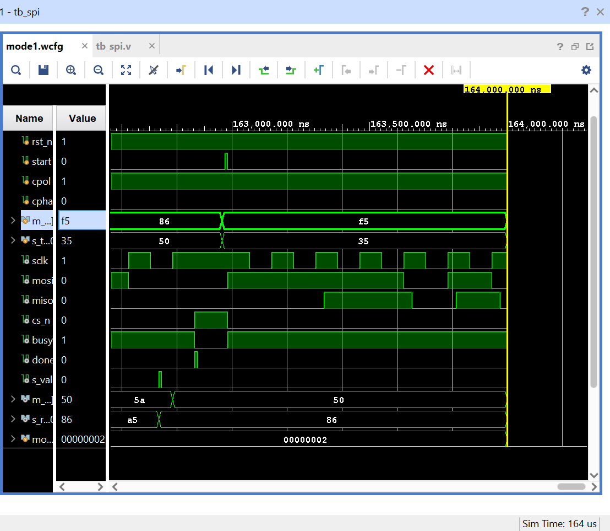
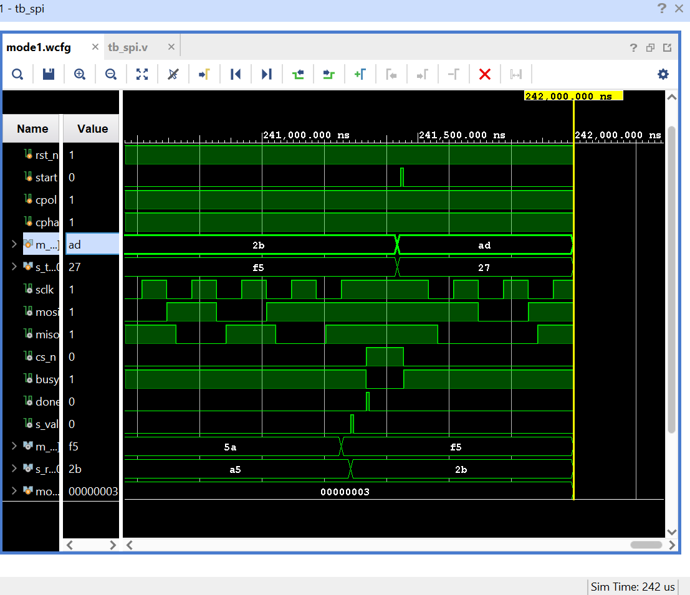

# Parameterized SPI Master/Slave (Verilog)

SPI master and slave supporting all four modes (CPOL/CPHA) with configurable data width and clock divider. Verified with a self-checking loopback testbench in Vivado 2023.1.

## Features
- Modes 0-3 (runtime `cpol`, `cpha` inputs)
- Parameters: `DATA_W` (default 8), `CLK_DIV` (SCLK half-period in system clocks)
- Slave oversamples SCLK using 2-FF synchronizers (system clock must be >= 4x SCLK)
- Self-checking testbench: 4 modes x 53 transfers (corner cases + random), 0 errors

## Structure
```
rtl/  spi_master.v, spi_slave.v
tb/   tb_spi.v
docs/ waveforms, utilization, timing, schematics
```

## SPI modes
| Mode | CPOL | CPHA | Sample edge | Shift edge |
|---|---|---|---|---|
| 0 | 0 | 0 | rising | falling |
| 1 | 0 | 1 | falling | rising |
| 2 | 1 | 0 | falling | rising |
| 3 | 1 | 1 | rising | falling |

## Simulation
Open Vivado, add `rtl/*.v` as design sources and `tb/tb_spi.v` as simulation source, run behavioral simulation, then `run all`. Expected output: `ALL TESTS PASSED`.

## Waveforms
Mode 0 (CPOL=0, CPHA=0):



Mode 1 (CPOL=0, CPHA=1):



Mode 2 (CPOL=1, CPHA=0):



Mode 3 (CPOL=1, CPHA=1):



## Synthesis results
Post-synthesis estimates, Artix-7 `xc7a35tcpg236-1`, 100 MHz target clock, Vivado 2023.1 (routing delay not included).

| Module | DATA_W | LUT | FF | WNS (ns) | Fmax (est.) |
|---|---|---|---|---|---|
| spi_master | 8 | 49 | 56 | 5.933 | ~246 MHz |
| spi_slave | 8 | 19 | 41 | 6.759 | ~308 MHz |

Screenshots: `docs/util_master.png`, `docs/util_slave.png`, `docs/timing_master.png`, `docs/timing_slave.png`

## Schematics (post-synthesis)
- [Master schematic](docs/master_schematic.pdf)
- [Slave schematic](docs/slave_schematic.pdf)

## Limitations
- Single chip-select, one transfer per `start` (no burst)
- `CLK_DIV` should be >= 4 for the slave synchronizer to track SCLK
- Verified in simulation only (no hardware test)
